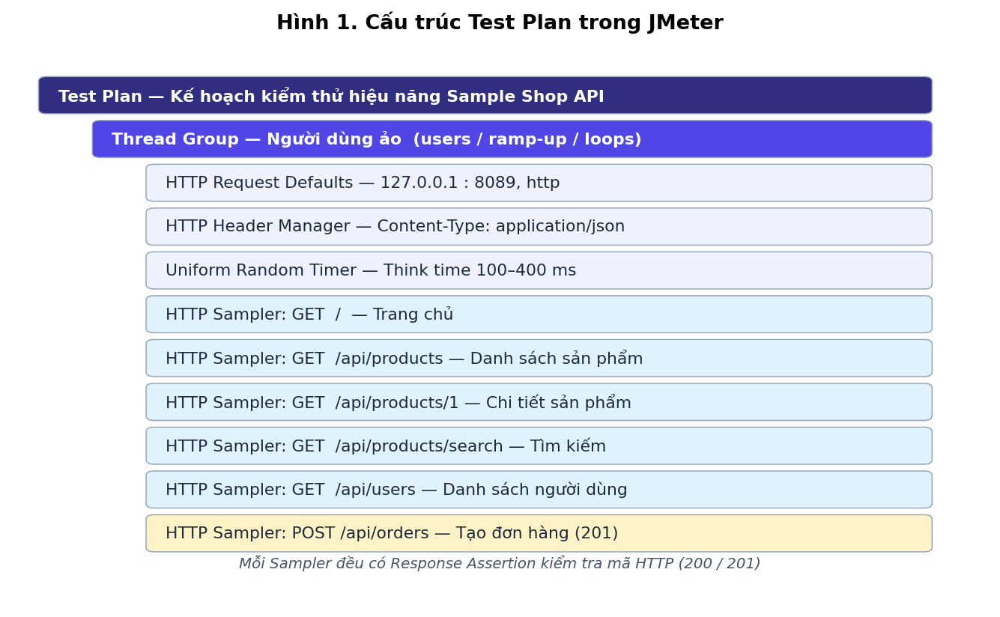
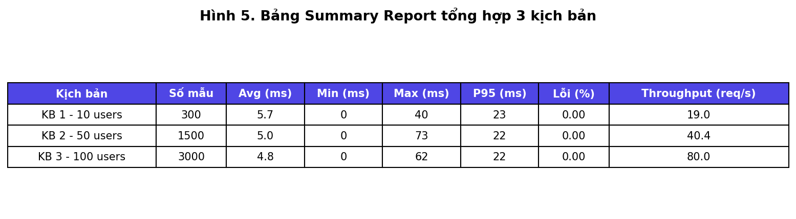
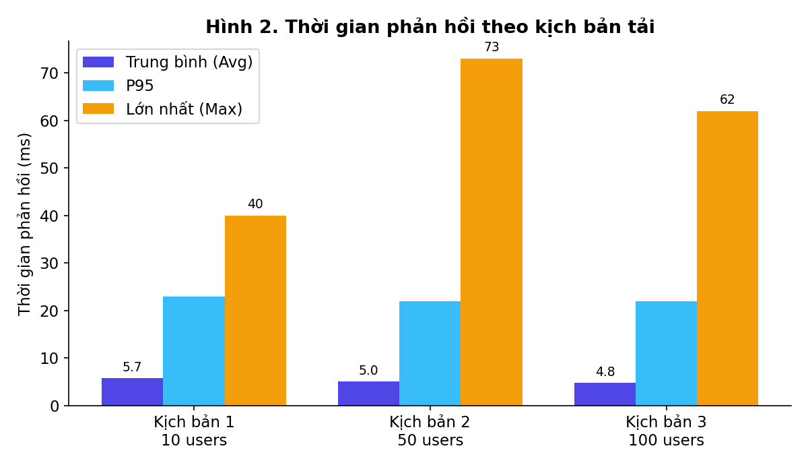
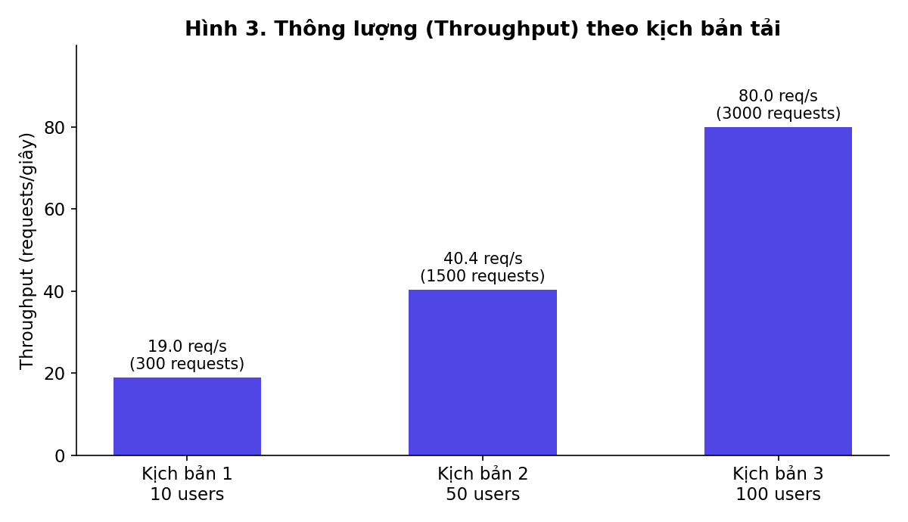
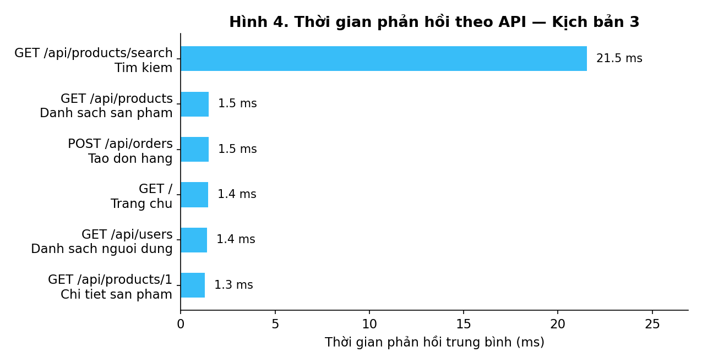

# Học công cụ kiểm thử Apache JMeter — Báo cáo thực hành cơ bản

| Thông tin | Nội dung |
|---|---|
| Sinh viên | Nguyen Ba Thien |
| GitHub | [thienba33](https://github.com/thienba33) |
| Môn học | Kiểm thử phần mềm |
| Công cụ | Apache JMeter 5.6.3 (cần Java 17) |
| Đề tài | Kiểm thử hiệu năng (Performance Testing) một Web API bằng JMeter |
| Repo nộp bài | https://github.com/thienba33/JMeter_testing |

> Báo cáo này trình bày ở **mức cơ bản**: giới thiệu công cụ, các thành phần chính, cách tạo một Test Plan đơn giản, chạy kiểm thử với 3 mức tải và đọc kết quả. Toàn bộ số liệu và hình ảnh trong báo cáo đều lấy từ lần chạy thật trong repo này (file `results/*/results.jtl`).

---

## Mục lục

1. [Giới thiệu](#1-giới-thiệu)
2. [Cài đặt JMeter](#2-cài-đặt-jmeter)
3. [Các thành phần cơ bản của JMeter](#3-các-thành-phần-cơ-bản-của-jmeter)
4. [Bài thực hành](#4-bài-thực-hành)
5. [Kết quả thực hiện](#5-kết-quả-thực-hiện)
6. [Kết luận](#6-kết-luận)
7. [Tài liệu tham khảo](#7-tài-liệu-tham-khảo)
8. [Cấu trúc thư mục](#8-cấu-trúc-thư-mục)

---

## 1. Giới thiệu

**Kiểm thử hiệu năng** là loại kiểm thử nhằm trả lời các câu hỏi: hệ thống phản hồi nhanh hay chậm khi có nhiều người dùng cùng lúc? Hệ thống xử lý được bao nhiêu request mỗi giây? Có request nào bị lỗi khi tải tăng không?

**Apache JMeter** là công cụ mã nguồn mở của Apache Software Foundation, viết bằng Java, chuyên dùng cho kiểm thử hiệu năng:

- Tạo nhiều **người dùng ảo (virtual users)** gửi request đồng thời tới server để mô phỏng tải thật.
- Hỗ trợ nhiều giao thức, phổ biến nhất là **HTTP/HTTPS** (web, REST API); ngoài ra còn có JDBC, FTP, JMS,...
- Đo được các chỉ số quan trọng: thời gian phản hồi (response time), thông lượng (throughput), tỉ lệ lỗi (error rate).
- Có giao diện đồ họa (GUI) để thiết kế kịch bản kiểm thử và chế độ dòng lệnh (non-GUI) để chạy kiểm thử tải.

---

## 2. Cài đặt JMeter

**Bước 1 — Cài Java:** JMeter cần Java 8 trở lên (bài này dùng Java 17). Kiểm tra bằng lệnh:

```bash
java -version
```

**Bước 2 — Tải JMeter:** tải bản binary `apache-jmeter-5.6.3.zip` (hoặc `.tgz`) tại trang chủ https://jmeter.apache.org/download_jmeter.cgi rồi giải nén.

**Bước 3 — Chạy JMeter:**

```bash
# Mở giao diện đồ họa (để thiết kế Test Plan)
bin/jmeter            # Linux/macOS
bin\jmeter.bat        # Windows

# Chạy kiểm thử bằng dòng lệnh (dùng khi chạy tải — xem mục 4.4)
bin/jmeter -n -t test-plans/sample-shop-performance-test.jmx -l results.jtl
```

> Lưu ý cơ bản: chỉ dùng GUI để **thiết kế và chạy thử ít request**. Khi chạy kiểm thử tải thật, luôn chạy **non-GUI** (`-n`) để JMeter không tốn tài nguyên cho giao diện, kết quả sẽ chính xác hơn.

Phiên bản sử dụng trong bài (kiểm chứng bằng lệnh `jmeter --version`): **Apache JMeter 5.6.3**, Java **17.0.21**.

---

## 3. Các thành phần cơ bản của JMeter

| Thành phần | Ý nghĩa |
|---|---|
| **Test Plan** | Kịch bản kiểm thử tổng thể — là phần tử gốc chứa mọi thành phần khác. |
| **Thread Group** | Nhóm người dùng ảo. Khai báo: số users, thời gian ramp-up (khoảng thời gian đưa toàn bộ users vào), số vòng lặp (loop). |
| **Sampler** | Một request gửi tới server, ví dụ HTTP Request (GET, POST,...). |
| **Config Element** | Cấu hình dùng chung, ví dụ HTTP Request Defaults (server, port mặc định), HTTP Header Manager (header gửi kèm). |
| **Timer** | Thời gian chờ giữa các request, mô phỏng thời gian người dùng suy nghĩ (think time). |
| **Assertion** | Điều kiện kiểm tra kết quả đúng/sai, ví dụ Response Assertion kiểm tra mã HTTP trả về có bằng 200 hay không. |
| **Listener** | Nơi xem và lưu kết quả: View Results Tree (xem từng request), Summary Report và Aggregate Report (bảng tổng hợp), hoặc xuất HTML Dashboard. |

Các chỉ số cần biết khi đọc kết quả:

| Chỉ số | Ý nghĩa |
|---|---|
| **Samples** | Tổng số request đã gửi |
| **Average / Avg** | Thời gian phản hồi trung bình (ms) |
| **Min / Max** | Thời gian phản hồi nhỏ nhất / lớn nhất (ms) |
| **P95** | 95% số request có thời gian phản hồi nhỏ hơn hoặc bằng giá trị này |
| **Error %** | Tỉ lệ request bị lỗi |
| **Throughput** | Số request hệ thống xử lý được trong 1 giây (req/s) — càng cao càng tốt |

---

## 4. Bài thực hành

### 4.1. Ứng dụng được kiểm thử

Để có đối tượng kiểm thử chạy ổn định và ai cũng chạy lại được, bài thực hành tự xây một **Web API mẫu (Sample Shop)** bằng Python (chỉ dùng thư viện chuẩn, không cần cài thêm gói) — mã nguồn tại `sample-app/app.py`, chạy ở địa chỉ `http://127.0.0.1:8089`:

| # | Endpoint | Mô tả | Mã HTTP đúng |
|---|---|---|---|
| 1 | `GET /` | Trang chủ | 200 |
| 2 | `GET /api/products` | Danh sách sản phẩm (100 sản phẩm mẫu) | 200 |
| 3 | `GET /api/products/1` | Chi tiết một sản phẩm | 200 |
| 4 | `GET /api/products/search?q=Laptop` | Tìm kiếm sản phẩm theo từ khóa | 200 |
| 5 | `GET /api/users` | Danh sách người dùng (50 người dùng mẫu) | 200 |
| 6 | `POST /api/orders` | Tạo đơn hàng mới (body JSON `{"productId": 1, "quantity": 2}`) | 201 |

Chạy ứng dụng mẫu:

```bash
python3 sample-app/app.py
# Kiểm tra nhanh: curl http://127.0.0.1:8089/api/health
```

### 4.2. Test Plan đã xây dựng

File Test Plan: `test-plans/sample-shop-performance-test.jmx` (mở được bằng JMeter GUI, hoặc sinh lại bằng `python3 scripts/build_test_plan.py`). Cấu trúc gồm 1 Thread Group chứa cấu hình dùng chung và 6 HTTP Sampler tương ứng 6 endpoint ở trên; mỗi Sampler có một Response Assertion kiểm tra mã HTTP; Timer tạo think time ngẫu nhiên 100–400 ms cho giống người dùng thật.



*Hình 1. Cấu trúc Test Plan trong JMeter.*

### 4.3. Ba kịch bản kiểm thử

Cùng một Test Plan được chạy 3 lần với mức tải tăng dần nhờ tham số dòng lệnh (`-Jusers`, `-Jramp`, `-Jloops`):

| Kịch bản | Số users | Ramp-up | Vòng lặp (loops) | Tổng số request |
|---|---|---|---|---|
| Kịch bản 1 — Cơ bản | 10 | 10 giây | 5 | 10 × 5 × 6 = **300** |
| Kịch bản 2 — Tải thường | 50 | 30 giây | 5 | 50 × 5 × 6 = **1.500** |
| Kịch bản 3 — Tải nặng | 100 | 30 giây | 5 | 100 × 5 × 6 = **3.000** |

### 4.4. Cách chạy lại toàn bộ bài thực hành

```bash
# Bước 1: chạy ứng dụng mẫu (ở một terminal riêng)
python3 sample-app/app.py

# Bước 2: chạy cả 3 kịch bản + xuất HTML Dashboard
bash scripts/run-tests.sh

# Hoặc chạy tay một kịch bản, ví dụ 50 users:
jmeter -n -t test-plans/sample-shop-performance-test.jmx \
       -l results/kich-ban-2-tai-thuong-50-users/results.jtl \
       -Jusers=50 -Jramp=30 -Jloops=5
```

Kết quả thô của từng lần chạy được lưu tại `results/<kịch-bản>/results.jtl`. Mở file `.jtl` bằng Listener trong JMeter GUI hoặc sinh **HTML Dashboard** bằng lệnh `jmeter -g results.jtl -o thu-muc-dashboard` (một dashboard mẫu có sẵn tại `results/dashboard-kich-ban-2-tai-thuong-50-users/index.html`).

---

## 5. Kết quả thực hiện

### 5.1. Bảng tổng hợp (Summary Report)



*Hình 5. Bảng Summary Report tổng hợp 3 kịch bản (số liệu đo từ file `results.jtl`).*

| Kịch bản | Số mẫu | Avg (ms) | Min (ms) | Max (ms) | P95 (ms) | Lỗi (%) | Throughput (req/s) |
|---|---|---|---|---|---|---|---|
| Kịch bản 1 — 10 users | 300 | 5,7 | 0 | 40 | 23 | 0,00 | 19,0 |
| Kịch bản 2 — 50 users | 1.500 | 5,0 | 0 | 73 | 22 | 0,00 | 40,4 |
| Kịch bản 3 — 100 users | 3.000 | 4,8 | 0 | 62 | 22 | 0,00 | 80,0 |

Tổng cộng **4.800 request**, toàn bộ đều thành công: các request GET trả mã **200**, request POST tạo đơn hàng trả mã **201**, đúng với Response Assertion đã đặt — **tỉ lệ lỗi 0% ở cả 3 kịch bản**.

### 5.2. Thời gian phản hồi theo kịch bản



*Hình 2. Thời gian phản hồi (Avg / P95 / Max) của 3 kịch bản.*

**Nhận xét:** Thời gian phản hồi trung bình gần như không đổi khi tăng tải (5,7 → 5,0 → 4,8 ms) và P95 luôn ở mức 22–23 ms. Giá trị Max (40–73 ms) chỉ xuất hiện ở một vài request đầu tiên khi mới thiết lập kết nối. Như vậy ở mức tối đa 100 người dùng đồng thời, ứng dụng mẫu vẫn phản hồi nhanh và ổn định.

### 5.3. Thông lượng (Throughput) theo kịch bản



*Hình 3. Thông lượng tăng theo số người dùng: 19,0 → 40,4 → 80,0 request/giây.*

**Nhận xét:** Throughput tăng gần như tỉ lệ thuận với số users (tăng 10 lần users thì throughput tăng khoảng 4,2 lần — throughput được tính trên toàn bộ thời gian chạy kể cả giai đoạn ramp-up). Điều này cho thấy hệ thống chưa bị nghẽn ở mức tải đã kiểm thử.

### 5.4. Thời gian phản hồi theo từng API



*Hình 4. Thời gian phản hồi trung bình của từng API ở kịch bản 3 (100 users).*

**Nhận xét:** Hầu hết các API chỉ mất khoảng 1,3–1,5 ms. Riêng API **tìm kiếm** (`GET /api/products/search`) chậm nhất với khoảng **21,5 ms**, vì phải lọc qua toàn bộ danh sách sản phẩm. Nếu cần tối ưu hệ thống, đây là API nên được xem xét đầu tiên.

---

## 6. Kết luận

- Đã cài đặt và sử dụng được **Apache JMeter 5.6.3** ở cả hai chế độ GUI (thiết kế Test Plan) và non-GUI (chạy kiểm thử tải).
- Đã xây dựng được một Test Plan hoàn chỉnh gồm Thread Group, HTTP Sampler, Config Element, Timer, Assertion và chạy thành công **3 kịch bản tải (10 / 50 / 100 users)** với tổng **4.800 request, tỉ lệ lỗi 0%**.
- Đã biết cách đọc kết quả cơ bản qua Summary Report và HTML Dashboard: hệ thống phản hồi trung bình khoảng **5 ms**, throughput đạt **80 req/s** ở 100 users, API tìm kiếm là API chậm nhất (≈ 21,5 ms).
- **Hạn chế:** ứng dụng được kiểm thử là ứng dụng mẫu nhẹ, chạy trên cùng một máy (localhost) với JMeter nên số liệu chỉ mang ý nghĩa học tập và so sánh tương đối giữa các kịch bản. Muốn đánh giá hiệu năng thật của một hệ thống, cần chạy JMeter và server trên các máy riêng và tăng dần tải cho tới khi hệ thống bắt đầu có lỗi.

---

## 7. Tài liệu tham khảo

1. Apache JMeter — trang chủ và tải công cụ: https://jmeter.apache.org/
2. Apache JMeter User's Manual: https://jmeter.apache.org/usermanual/index.html
3. Getting Started — hướng dẫn bắt đầu với JMeter: https://jmeter.apache.org/usermanual/get-started.html
4. Best Practices — các lưu ý khi chạy kiểm thử tải (chạy non-GUI, giảm Listener,...): https://jmeter.apache.org/usermanual/best-practices.html

---

## 8. Cấu trúc thư mục

```text
JMeter_testing/
├── README.md                        # Báo cáo này
├── sample-app/
│   └── app.py                       # Web API mẫu được kiểm thử (Python, cổng 8089)
├── test-plans/
│   └── sample-shop-performance-test.jmx   # Test Plan của JMeter
├── scripts/
│   ├── build_test_plan.py           # Sinh file .jmx
│   ├── run-tests.sh                 # Chạy 3 kịch bản + xuất dashboard
│   ├── generate_charts.py           # Vẽ Hình 2–5 từ file results.jtl
│   └── generate_testplan_diagram.py # Vẽ Hình 1
├── results/
│   ├── kich-ban-1-co-ban-10-users/results.jtl
│   ├── kich-ban-2-tai-thuong-50-users/results.jtl
│   ├── kich-ban-3-stress-100-users/results.jtl
│   ├── dashboard-kich-ban-2-tai-thuong-50-users/   # HTML Dashboard mẫu
│   └── tong-hop-so-lieu.csv         # Số liệu tổng hợp 3 kịch bản
└── images/                          # Hình minh họa trong báo cáo (Hình 1–5)
```
